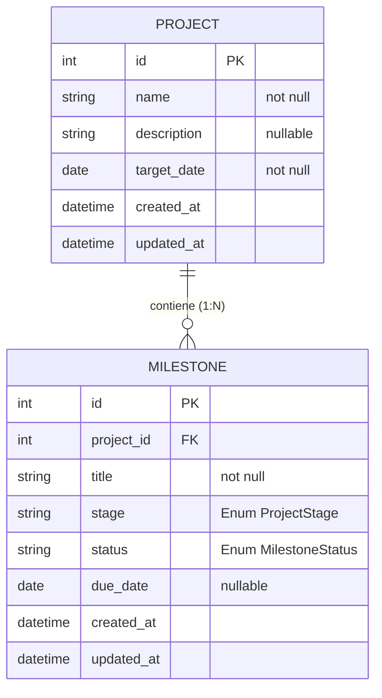

# Especificación de Diseño: Dashboard de Seguimiento de Proyectos de Software

**Fecha:** 2026-10-11  
**Estado:** Aprobado para Planificación  
**Ruta:** `docs/superpowers/specs/2026-10-11-dashboard-seguimiento-proyectos-design.md`

---

## 1. Contexto y Objetivos

### 1.1 Problema
En entornos de desarrollo de software, la gestión simultánea de múltiples proyectos suele adolecer de falta de visibilidad ejecutiva centralizada. La dispersión de información en planillas o canales de mensajería genera detección tardía de desvíos en fechas comprometidas de entrega (*target dates*), poniendo en riesgo el paso a producción.

### 1.2 Propósito del Sistema
Proveer un **Dashboard de Seguimiento de Proyectos** que permita:
1. **A Tech Leads / Project Managers:** Registrar proyectos, estructurar sus hitos (*milestones*) por fase técnica y actualizar su evolución de forma ágil.
2. **A Directores y Líderes de Área:** Monitorear en tiempo real el estado global mediante métricas clave (KPIs), gráficos de distribución de etapas y un semáforo de salud/riesgo automatizado.

### 1.3 Alcance y Requisitos de Entrega (Alineación con `consigna.md`)
* **Aplicación Completa:** Frontend interactivo, Backend REST y Persistencia en Base de Datos relacional.
* **Trazabilidad y Evidencia del Proceso:** Especificación (`spec`), Plan de implementación (`plan`), historial de commits y archivo `AGENTS.md` como garante de la gobernanza del contexto del agente de IA.
* **Defensa Técnica (Demo Day):** Justificación de arquitectura, decisiones de diseño, gestión de contexto y resolución de desvíos.

---

## 2. Arquitectura del Sistema

### 2.1 Estilo Arquitectónico
Se adopta una **Arquitectura Desacoplada (Client-Server)** en monorepo estructurado:
* **Backend API (`/backend`):** Servicio REST en **FastAPI** (Python 3.10+) encargado de persistencia, validaciones de esquema, reglas de negocio y cálculo dinámico de salud.
* **Frontend SPA (`/frontend`):** Aplicación web reactiva construida con **Vite + React + Tailwind CSS**, visualizando métricas interactivas mediante **Chart.js**.
* **Persistencia (`/backend/projects.db`):** Base de datos relacional embebida **SQLite** administrada mediante **SQLAlchemy 2.0**.
* **Gobierno de IA (`AGENTS.md`):** Archivo raíz que instruye a los agentes sobre convenciones, ejecución, tests y límites arquitectónicos para mantener el hilo contextual entre sesiones.

### 2.2 Estructura de Archivos
```
tp-final/
├── AGENTS.md                                     # Reglas operativas y contexto para agentes de IA
├── consigna.md                                   # Documento de entrega y defensa para el Demo Day
├── idea.md                                       # Idea original y requerimientos iniciales
├── estados.md                                    # Definición de pipeline y estados de salud
├── docs/
│   └── superpowers/
│       ├── specs/
│       │   └── 2026-10-11-dashboard-seguimiento-proyectos-design.md
│       └── plans/
│           └── 2026-10-11-dashboard-seguimiento-proyectos-plan.md
├── backend/
│   ├── app/
│   │   ├── __init__.py
│   │   ├── main.py                               # Configuración de FastAPI, CORS y ruteo
│   │   ├── database.py                           # Engine SQLite y sesión SQLAlchemy
│   │   ├── models.py                             # Modelos ORM (Project, Milestone)
│   │   ├── schemas.py                            # Esquemas Pydantic v2 de entrada y salida
│   │   ├── crud.py                               # Consultas y mutaciones a base de datos
│   │   └── services.py                           # Lógica de cálculo de salud y progreso
│   ├── tests/
│   │   ├── __init__.py
│   │   ├── conftest.py                           # Fixtures de BD en memoria y TestClient
│   │   ├── test_services.py                      # Pruebas unitarias de reglas de salud
│   │   └── test_api.py                           # Pruebas de integración de endpoints
│   ├── requirements.txt                          # fastapi, uvicorn, sqlalchemy, pydantic, pytest, httpx
│   └── README.md                                 # Guía de ejecución del backend
└── frontend/
    ├── src/
    │   ├── api/
    │   │   └── client.js                         # Cliente HTTP (fetch/axios) contra la API
    │   ├── components/
    │   │   ├── Navbar.jsx                        # Encabezado y branding
    │   │   ├── MetricCards.jsx                   # Tarjetas KPI superiores (Total, On Track, At Risk, Delayed)
    │   │   ├── StageChart.jsx                    # Gráfico de distribución de fases (Chart.js)
    │   │   ├── FilterBar.jsx                     # Buscador y filtros de salud / etapa
    │   │   ├── ProjectCard.jsx                   # Tarjeta de proyecto con semáforo y progreso
    │   │   ├── MilestoneList.jsx                 # Checklist / acordeón de hitos por etapa
    │   │   └── ProjectModal.jsx                  # Modal para crear y editar proyectos e hitos
    │   ├── App.jsx                               # Contenedor principal y gestión de estado
    │   ├── index.css                             # Tailwind CSS
    │   └── main.jsx                              # Punto de entrada Vite
    ├── package.json                              # Scripts dev/build y dependencias de React
    ├── vite.config.js                            # Configuración de Vite y proxy local
    └── README.md                                 # Guía de ejecución del frontend
```

---

## 3. Modelo de Datos y Dominio

### 3.1 Enumeraciones de Dominio
* **`ProjectStage` (Etapas del Ciclo de Vida):**
  * `PLANNING`: Planificación y definición de requerimientos.
  * `DESIGN`: Diseño conceptual y UX/UI.
  * `DEVELOPMENT`: Construcción activa de software.
  * `TESTING`: Control de calidad y pruebas QA.
  * `READY_FOR_DEPLOY`: Listo y aprobado para release.
  * `DONE`: Desplegado y finalizado en producción.
* **`HealthStatus` (Semáforo de Salud / Riesgo):**
  * `ON_TRACK` (🟢 Verde): Cronograma en regla, sin riesgos críticos detectados.
  * `AT_RISK` (🟡 Amarillo): Alerta temprana; fecha límite próxima con etapas tempranas o hitos incompletos.
  * `DELAYED` (🔴 Rojo): Superó la fecha objetivo comprometida sin finalizar.
  * `COMPLETED` (🔵 Azul): Proyecto completado satisfactoriamente.
* **`MilestoneStatus` (Estado del Hito):**
  * `PENDING`: Pendiente de inicio.
  * `IN_PROGRESS`: En ejecución activa.
  * `COMPLETED`: Hito finalizado.

### 3.2 Diagrama Entidad-Relación (SQLAlchemy)


### 3.3 Reglas de Negocio y Algoritmo de Salud Dinámica (`services.py`)
La salud **no se almacena de forma rígida en la BD**, sino que se calcula dinámicamente al consultar los proyectos (`today = date.today()`):
1. **Condición `COMPLETED`:** Si todos los hitos del proyecto tienen estado `COMPLETED` (o si la etapa actual es `DONE`).
2. **Condición `DELAYED`:** Si `today > target_date` y el proyecto no está completado.
3. **Condición `AT_RISK`:**
   * Si faltan 7 días corridos o menos para `target_date` (`0 <= (target_date - today).days <= 7`) y el progreso es inferior al 70%.
   * O si la etapa activa sigue siendo `PLANNING` o `DESIGN` restando menos del 30% del tiempo total previsto.
4. **Condición `ON_TRACK`:** En cualquier otro escenario donde el avance sea coherente con los plazos.

**Cálculo de Progreso Porcentual:**
$$\text{progreso} = \left( \frac{\text{hitos\_completados}}{\text{total\_hitos}} \right) \times 100$$
*(Si un proyecto no tiene hitos cargados, el progreso se calcula en 0%).*

**Plantilla de Hitos por Defecto:**
Al crear un nuevo proyecto, el backend inicializa automáticamente 5 hitos base asociados a las etapas principales:
1. *"Definición de alcance y arquitectura"* (`PLANNING`)
2. *"Diseño de interfaz y contratos"* (`DESIGN`)
3. *"Construcción e implementación"* (`DEVELOPMENT`)
4. *"Pruebas y aseguramiento de calidad"* (`TESTING`)
5. *"Pase a producción"* (`READY_FOR_DEPLOY`)

---

## 4. Contrato de la API REST

### 4.1 Endpoints de Proyectos (`/api/projects`)
* `GET /api/projects`: Lista proyectos con filtros opcionales (`?stage=DEVELOPMENT&health=AT_RISK&search=query`). Devuelve cada proyecto con su `health_status`, `progress_percentage`, `current_stage` e hitos asociados.
* `POST /api/projects`: Crea un proyecto. Body: `{ name: str, description?: str, target_date: date }`. Genera los hitos base por defecto. Retorna `201 Created`.
* `GET /api/projects/{id}`: Detalle completo de un proyecto puntual con sus hitos ordenados.
* `PUT /api/projects/{id}`: Actualización completa o parcial de nombre, descripción o fecha límite.
* `DELETE /api/projects/{id}`: Eliminación física en cascada del proyecto y sus hitos. Retorna `204 No Content`.

### 4.2 Endpoints de Milestones (`/api/projects/{project_id}/milestones`)
* `POST /api/projects/{project_id}/milestones`: Agrega un hito personalizado. Body: `{ title: str, stage: str, due_date?: date }`.
* `PATCH /api/projects/{project_id}/milestones/{milestone_id}`: Actualización de estado del hito (`status`: `PENDING` | `IN_PROGRESS` | `COMPLETED`) o título/fase.
* `DELETE /api/projects/{project_id}/milestones/{milestone_id}`: Elimina un hito puntual.

### 4.3 Endpoints de Métricas (`/api/metrics`)
* `GET /api/metrics`: Retorna estadísticas agregadas calculadas al vuelo para el dashboard:
  ```json
  {
    "total_projects": 12,
    "active_projects": 9,
    "completed_projects": 3,
    "health_summary": {
      "on_track": 6,
      "at_risk": 2,
      "delayed": 1,
      "completed": 3
    },
    "stage_distribution": {
      "PLANNING": 2,
      "DESIGN": 1,
      "DEVELOPMENT": 4,
      "TESTING": 1,
      "READY_FOR_DEPLOY": 1,
      "DONE": 3
    }
  }
  ```

---

## 5. Diseño de Interfaz de Usuario (Frontend)

### 5.1 Jerarquía Visual y Componentes
1. **Header / Navbar:** Logo corporativo, título del sistema y botón de acción principal destacado `+ Nuevo Proyecto`.
2. **Dashboard de KPIs (`MetricCards.jsx`):** Cuatro tarjetas con contadores grandes y códigos de color:
   * Total de Proyectos (Gris/Azul)
   * En Regla (Verde)
   * En Riesgo (Amarillo/Ámbar)
   * Retrasados (Rojo)
3. **Distribución Visual (`StageChart.jsx`):** Gráfico de barras horizontales o dona (Chart.js) reflejando los proyectos por fase.
4. **Panel de Filtros (`FilterBar.jsx`):** Buscador de texto reactivo y botones de filtrado rápido por semáforo de salud.
5. **Grilla de Proyectos (`ProjectCard.jsx`):**
   * Semáforo de salud en badge prominente.
   * Nombre, descripción y fecha límite con badge de días restantes o días demorado.
   * Barra de porcentaje de avance general.
   * Sección colapsable/acordeón de hitos (`MilestoneList.jsx`) con checkboxes para marcar hitos como completados en un clic.
   * Menú de acciones: Editar datos y Eliminar proyecto.
6. **Modal de Gestión (`ProjectModal.jsx`):** Formulario accesible con validación en tiempo real para alta y modificación.

---

## 6. Manejo de Errores y Validaciones

* **Validaciones Backend (Pydantic v2):**
  * Rechazo con `422 Unprocessable Entity` si `name` está vacío o supera 100 caracteres.
  * Formato ISO estricto para fechas (`YYYY-MM-DD`).
  * Validación de integridad referencial: `404 Not Found` ante accesos a IDs inexistentes.
* **Manejo en Frontend:**
  * Alertas tipo Toast flotantes ante operaciones exitosas o fallidas.
  * Bloqueo de botones de envío durante llamadas asíncronas para prevenir dobles submits.
  * Estados visuales vacíos (*Empty States*) cuando no haya proyectos registrados o tras filtros sin resultados.

---

## 7. Estrategia de Testing

* **Backend (`pytest`):**
  * `test_services.py`: Pruebas unitarias parametrizadas validando cada condición del algoritmo de salud (fechas futuras, pasadas, límites de 7 días, hitos incompletos).
  * `test_api.py`: Pruebas de integración HTTP usando base de datos SQLite en memoria (`sqlite:///:memory:`):
    * Creación de proyecto y verificación de generación automática de hitos base.
    * Actualización de hitos y recálculo automático de progreso.
    * Verificación de métricas en `/api/metrics`.
    * Borrado en cascada.
* **Frontend:**
  * Verificación manual interactiva de flujo completo e integración contra el backend local.

---

## 8. Estrategia de Entrega y Defensa (Demo Day)

El proyecto documentará explícitamente en `consigna.md`:
1. **Cómo se ejecuta:** Instrucciones paso a paso para levantar backend (`uvicorn`) y frontend (`npm run dev`).
2. **Arquitectura:** Diagramas y justificación de FastAPI + React/Vite + SQLite.
3. **Qué decidí yo:** Elección del cálculo dinámico de salud vs persistencia estática, generación de hitos por defecto, y desacoplamiento frontend/backend.
4. **Cómo gestioné el contexto:** Utilización de `AGENTS.md` como contrato vivo del agente, especificación formal (`spec`) y desglose en plan de tareas independientes.
5. **Qué salió mal:** Registro honesto de desvíos detectados y cómo fueron corregidos en el diálogo de desarrollo.
